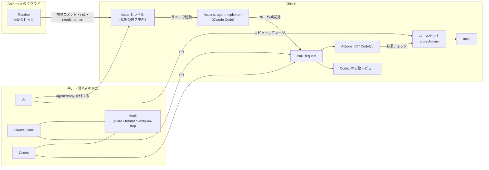
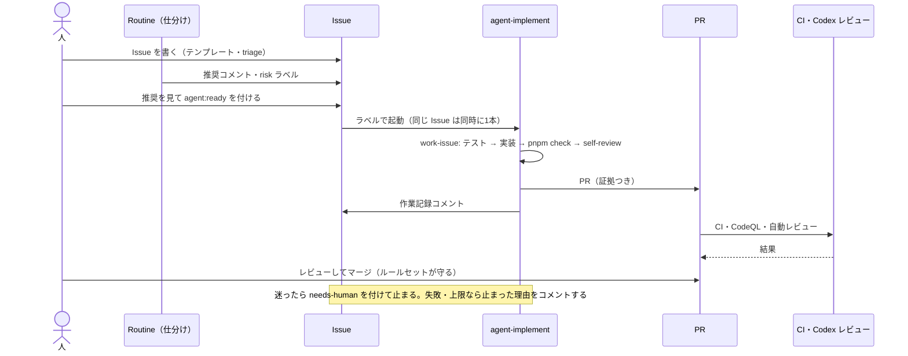

# ハーネス・ループ・CI/CD の全体像

このリポジトリで、AI エージェント（Claude Code / Codex）と人がどう一緒に開発しているかの地図。
細かい決まりは各リンク先にある。ここは「どこに何があり、いつ何が動くか」を見渡すためのページ。

- **ハーネス** ＝ モデル以外のすべて（ルール・道具・権限・検証・人が入る地点）。1回の作業を整える
- **ループ** ＝ 「指示 → 実行 → 確かめる → 次を決める / 止まる」を人が毎回プロンプトを打たずに回す仕組み。ハーネスの上で動く
- **CI/CD** ＝ GitHub 上の自動チェックと自動化。人とエージェントの変更を、同じ基準で確かめる

## 1. 全体図

## 2. ファイルの地図

| 部品 | ファイル | 何をするか | Claude Code | Codex |
|---|---|---|---|---|
| ルール（毎回読む） | `AGENTS.md`、各ディレクトリの `AGENTS.md` | チーム共通の決まり、完了の定義、Code Review Rules | `CLAUDE.md` から `@AGENTS.md` で読む | そのまま読む |
| ルール（パス限定） | `.claude/rules/tests.md` | テストを書くときの決まり | ○ | —（AGENTS.md の階層で代わりにする） |
| 手順 | `.agents/skills/*/SKILL.md` | tdd-fix・add-endpoint・db-migration・pr-evidence・self-review・work-issue・babysit-pr・triage | `.claude/skills/`（シンボリックリンク） | ○ |
| 設計の理由 | `docs/adr/` | 決めたことと理由 | 必要なときに読む | 同じ |
| 確かめる役 | `.claude/agents/`、`.codex/agents/` | reviewer・test-auditor・triager（読むだけ） | ○ | ○ |
| Hook | `scripts/agent/hooks/`（設定は `.claude/settings.json`・`.codex/hooks.json`） | 禁止操作を止める・整形・止まる前の検証 | ○ | ○（中身は共通） |
| 権限 | `.claude/settings.json`、`.codex/config.toml` | 許可・確認・禁止のコマンド、サンドボックス | allow / ask / deny、sandbox | workspace-write、on-request、ネットワークなし |
| 外部の道具 | `.mcp.json`、`.codex/config.toml`、[docs/mcp-policy.md](mcp-policy.md) | GitHub（読み取り専用）・Playwright | ○ | ○ |
| 状態 | Issue・ラベル・PR、`LEARNINGS.md`、[docs/loops/state.md](loops/state.md) | 進み具合・作業記録・証拠・学び | 同じ | 同じ |
| ループ | [docs/loops/README.md](loops/README.md)、`docs/loops/goal-templates.md`、`docs/loops/routines/` | 4タイプのループと台帳 | `/goal`・`/loop`・Routine・Actions | `/goal` |
| CI/CD | `.github/workflows/`、`.github/dependabot.yml`、ルールセット | 自動チェック・自動化・main の保護 | — | — |
| ハーネスのテスト | `scripts/agent/hooks/guard.test.mjs` | guard Hook が止める・通すを確かめる（`pnpm test:harness`） | — | — |

## 3. できごとごとに、何が動くか

| できごと | 動くもの | 結果 |
|---|---|---|
| エージェントがコマンドを打つ・ファイルを編集しようとする | 権限設定（Claude）→ **guard Hook**（両方）。シェルコマンドは、さらにサンドボックスの中で動く | 禁止操作は実行前に止まり、理由がエージェントに返る |
| エージェントがファイルを編集した | **format Hook** | Biome で整形（失敗しても止めない） |
| エージェントが「終わった」と止まろうとする | **verify-on-stop Hook** | コードを変えていれば `pnpm check`。落ちたら作業に戻す（同じセッションで最大3回。それを超えたら止めて人に任せる） |
| PR を出す前 | Skill `self-review` → reviewer・test-auditor | `VERDICT: NG` は直してから PR |
| PR を出した・更新した | CI（check・e2e・secrets）、CodeQL、Codex の自動レビュー、agent-auto-merge（条件を満たすときだけ） | 結果が PR に付く |
| `agent/**` ブランチに push | CI | エージェントの PR は GITHUB_TOKEN で作るため CI が自動で走らない。push で代わりに走らせる |
| PR やIssue に `@claude` と書く | claude.yml | Claude Code がそのコメントに対応する |
| 人が Issue に `agent:ready` / `agent:report-only` を付ける | agent-implement | Claude Code が Skill work-issue で PR（または報告）を作り、作業記録をコメントする |
| 毎朝（Routine の設定どおり。手順では平日 9:00） | Routine（毎朝の仕分け） | `triage` の Issue に推奨コメントと `risk:*`、必要なら `needs-human` |
| マージしようとする | ルールセット protect-main | PR 必須・必須チェックの通過・レビューのスレッド解決が揃わないとマージできない |
| 毎週 | Dependabot、CodeQL（月曜 3:00 UTC） | 依存の版上げ PR、定期の脆弱性スキャン |

### Issue が main に入るまで

## 4. 守りの重なり

同じ禁止を、複数の層で止めている（1つが抜けても止まるように）。

| 禁止したいこと | ルール（お願い） | 権限設定（Claude） | guard Hook（両方） | サンドボックス | GitHub 側 |
|---|---|---|---|---|---|
| 依存の追加 | AGENTS.md | deny | ○ | Codex はネットワークなし（Claude は npm レジストリを許可している） | — |
| 既存テストの削除・`skip` | AGENTS.md、`.claude/rules/tests.md` | — | ○ | — | Code Review Rules（Codex のレビュー・reviewer） |
| main への直接 push・強制 push | AGENTS.md | ask・deny | ○ | — | ルールセット（PR 必須・強制 push 禁止） |
| マージ | AGENTS.md | deny | ○ | — | ルールセット（必須チェック） |
| `.env`（秘密情報）を読む・書く | — | Read の deny | ○ | — | gitleaks（CI） |
| CI・ハーネス・ロックファイルの書き換え | — | — | ○ | — | CODEOWNERS（ハーネス担当のレビュー） |
| 適用済みマイグレーションの編集 | packages/db/AGENTS.md | — | ○ | — | CODEOWNERS |
| 外部への送信 | AGENTS.md | ask（`gh pr create`・`gh issue comment` など） | — | Claude は許可したドメインだけ、Codex はネットワークなし | — |

- サンドボックスが包むのはシェルコマンドだけ。Claude の Edit・Write などの組み込みの道具は、権限設定と guard Hook で守る
- このリポジトリでは Codex のコマンドルール（Rules）を設定していないので、Codex は **guard Hook とサンドボックスが主な守り**になる
- ハーネスのファイルは guard Hook で AI が編集できない。直すときは人が PR を出す（CODEOWNERS のレビューが付く）

## 5. どこで何が動くか（実行場所と認証）

| 実行場所 | 動くもの | 認証 | 上限 |
|---|---|---|---|
| 手元 | Claude Code、Codex、Hook、`/goal`、`/loop` | Claude Max、ChatGPT Plus のログイン | `/goal` は完了条件の中で決める（ひな形は30ターン）、`/loop` は7日 |
| Anthropic のクラウド | Routine（毎朝の仕分け） | Claude Max のログイン（`/web-setup`） | 1回10件、1日の実行回数はプランの上限 |
| GitHub Actions | agent-implement、claude.yml | Secrets の `CLAUDE_CODE_OAUTH_TOKEN`（Max のトークン、`claude setup-token` で発行） | 30分、40ターン（claude.yml は30ターン）、同じ Issue は同時に1本 |
| GitHub Actions | CI、CodeQL、agent-auto-merge | `GITHUB_TOKEN`（ジョブごとに最小の権限） | ジョブごとの `timeout-minutes` |
| Codex のクラウド | PR の自動レビュー | ChatGPT Plus（Codex の設定でリポジトリをつなぐ） | Codex のプランの上限 |

- **Codex は CI では動かさない**（公式の GitHub Action は API キーが必要。ログイン情報を流用する非公式の方法は使わない）
- **Agent SDK は使わない**（サブスクリプションのトークンを SDK で使うのは、個人の実験以外は規約上グレー）

## 6. CI/CD の一覧

| ワークフロー | きっかけ | 権限 | 中身 | 必須チェック |
|---|---|---|---|---|
| `ci.yml` | PR、main と `agent/**` への push | contents: read | check（lint・型・依存ルール・テスト・ハーネスのテスト）、e2e（Playwright）、secrets（gitleaks） | 3つとも必須 |
| `codeql.yml` | PR、main への push、毎週月曜 | contents: read、security-events: write | JavaScript / TypeScript の静的解析 | — |
| `claude.yml` | コメントに `@claude` | contents・pull-requests・issues: write | Claude Code がコメントに対応 | — |
| `agent-implement.yml` | Issue に `agent:ready` / `agent:report-only`（人が付けたとき） | contents・pull-requests・issues: write | work-issue の手順で PR か報告。失敗したら止まった理由をコメントし `needs-human` | — |
| `agent-auto-merge.yml` | PR の作成・更新・ラベル | contents・pull-requests: write | 変数 `AUTO_MERGE_ENABLED` が true で、`agent:auto-merge` と `risk:low` があり、docs か `.md` だけの変更なら自動マージを予約 | — |
| Dependabot | 毎週 | — | npm（minor・patch はまとめる、公開から3日待つ、TypeScript と `@types/node` の大きな版上げは出さない）、Actions（1つにまとめる） | — |

**ルールセット protect-main**（`scripts/setup/github.sh` で作成）: main の削除禁止、強制 push 禁止、PR 必須（承認数 0・レビューのスレッド解決は必須）、必須チェック（check・e2e・secrets）。

> 承認数を 0 にしているのは、この題材を1人で回すため。チームで使うなら 1 以上にし、`require_code_owner_review` を有効にする。

## 7. ハーネスを変えるとき

1. 記録（Issue の作業記録、Actions の実行記録、PR のレビュー）から、つまずきを `LEARNINGS.md` に書く。採用するかは人が決める
2. ハーネスのファイルは人がブランチを切って直す（guard Hook で AI は編集できない）
3. guard Hook を変えたら `scripts/agent/hooks/guard.test.mjs` にケースを足し、`pnpm test:harness` を通す
4. ループを足す・変えるときは [docs/loops/README.md](loops/README.md) の台帳を更新する（責任者・上限・止め方が決まっていないループは動かさない）
5. PR を出す。CODEOWNERS でハーネス担当のレビューが付く
